# FieldSignal delivery reference

An environmental monitoring application used to demonstrate a multi-team monorepo with **independent component publication and application-level promotion**.

Synthetic river observations travel through PostgreSQL, a transactional outbox and Kafka to an incident register. Two React consoles exercise a business capability spanning two Java services. Shared Java and UI libraries demonstrate dependency-aware builds.


## Delivery model

```mermaid
flowchart LR
  PR[Source PR] --> Nx[Nx affected tests and builds]
  Nx --> Publish[Protected main: publish affected artifacts]
  Publish --> Registry[GHCR + public Maven/npm packages]
  Registry --> Candidate[Select complete application candidate]
  Candidate --> Qualify[Argo CD + business tests in disposable kind]
  Qualify --> Evidence[Signed qualification for candidate digest]
  Evidence --> Promote[Reviewed environment pin change]
  Promote --> Argo[One Argo Application per environment]
```



Build dependencies come from Maven/npm. Contract relationships that cannot be inferred are declared with native Nx `implicitDependencies`. There is no custom component catalog, impact engine or release JSON format. Ownership is review metadata in CODEOWNERS; it does not define deployment boundaries.

- Images are published independently to `ghcr.io/rpjweez/delivery-reference-platform/<component>`.
- Maven libraries and the build parent use public GitHub Packages with explicit immutable versions.
- The UI package is `@rpjweez/fieldsignal-ui` on GitHub Packages.
- The shared chart is `oci://ghcr.io/rpjweez/charts/application`.
- [fieldsignal-deploy](https://github.com/RPJWeez/fieldsignal-deploy) selects, qualifies and promotes whole-application candidates.

Publication never updates an environment. A candidate retains unchanged component digests. Promotion does not rebuild anything. GitOps pins the candidate's OCI **digest**, including its vendored chart dependency and image selections.

## Local development

Java 21, Node 22.12+, Docker, Python 3 and Helm 3 are required. The Maven Wrapper pins Maven; Nx Cloud is disabled.

```sh
npm ci
make infra
make build
make dev
```

Open [station console](http://127.0.0.1:5173) and [operator console](http://127.0.0.1:5174). Submit 4.8 meters, then review and acknowledge the resulting incident. Data and thresholds are synthetic; this is not a flood warning system.

```sh
make verify                 # Real Nx selection tests + Helm behavior/schema checks
make test-java              # Inferred Java component tests
npm run typecheck
npm run test:functional     # Business workflow against running consoles
make smoke                  # API, Kafka replay and idempotency against local infrastructure
make infra-down             # Retains local data volumes
```

Java library publication requires an explicit version bump when bytes change. Local development may build workspace libraries; production image builds resolve published dependency versions. See [publishing](docs/publishing.md), [architecture](docs/architecture.md), [local development](docs/local-development.md) and [progress](PROGRESS.md).

## Scope

CI and publication workflows, signed artifact evidence, a reusable chart, and reusable candidate qualification are implemented here. Deployment configuration and candidate/promotion workflows live in the deployment repository. Qualification uses one real Argo CD Application and published artifacts, rather than source-checkout rebuilds.

This is a free-tier demonstration: public repositories/packages, standard hosted runners, disposable kind clusters and local Argo CD. No permanent cloud resources or paid Apigee instance are created. Apigee integration remains a future optional adapter; frontend development proxies are not an Apigee implementation.

The repository has not been assigned an open-source license.
