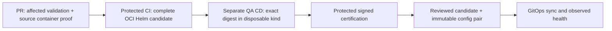

# FieldSignal delivery reference

One application per source repository: synthetic river observations flow through
PostgreSQL, a transactional outbox and Kafka to an incident register. Two React consoles,
two Java services and private Java/UI source libraries exercise the delivery path.
This is demonstration data and behavior, not a flood warning system.

```sh
make dev       # docker compose up --build -d
make verify    # docker compose run --build --rm verify
make stop      # docker compose stop; retain data
```

Open the [station console](http://127.0.0.1:5173) and
[operator console](http://127.0.0.1:5174). Submit 4.8 meters, then review and acknowledge
the incident. Git and Docker/Compose v2 are sufficient for the container path; Make is
optional. [Native IDE commands and contributor guide](docs/local-development.md).



The app calls [shared delivery workflows](https://github.com/RPJWeez/pipelines/tree/codex/extract-application-delivery)
through a small pinned YAML caller. Pipeline scripts/tests/toolchains live there; this repo
owns native builds, runtime declarations and business tests. See the
[migration and activation notes](docs/shared-pipeline-migration.md).

Maven/npm own native builds; Nx retains graph analysis, orchestration and caches. Private
libraries build from the same checkout without registry access or release/adoption-pin
bookkeeping. Bake supplies native image metadata; Helm supplies runtime declarations.
A shared adapter checks image completeness. CI builds every application image and packages
the app-owned chart with exact digests, vendored dependencies, schema and build identities.
Chart versions are assigned by run/attempt. CI does not deploy or claim runtime qualification.

The [companion deployment repository](https://github.com/RPJWeez/fieldsignal-deploy)
consumes the digest handoff, runs isolated QA, certifies against current policy, and validates
promotion pairs. Runtime config pins an existing reviewed commit; the outer GitOps pointer
may follow protected main. Promotion/rollback never rebuilds or substitutes images.

The migration has demonstrated local source builds, cache restoration/invalidation,
real API/Kafka/browser behavior and second-application build/runtime adapters. Protected
registry publication and cross-repository QA/certification remain integration gates.
No shared/production deployment, live protection changes or artifact deletion occurred.
Read the [implementation checkpoint](docs/application-golden-path-checkpoint.md) for exact
executed checks and remaining work; prepared code is not a claim of live capability.

See [architecture](docs/architecture.md), [pipeline](docs/pipeline.md),
[release protocol](docs/release-protocol.md) and [operator recovery](docs/operator-runbook.md).
Retain historical artifacts and compatible rollback candidates. Desired state is coherent,
not an atomic runtime cutover; rollback does not reverse data or external events.

This reference uses public GitHub/GHCR, standard hosted runners and disposable local/kind
infrastructure. No permanent cloud resources or paid platform were created. The repository
has not been assigned an open-source license.
