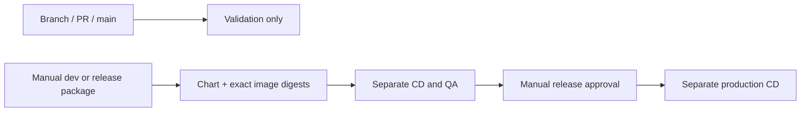

# FieldSignal delivery reference

One application per source repository: synthetic river observations flow through
PostgreSQL, a transactional outbox and Kafka to an incident register. Two React consoles,
two Java services and private Java/UI source libraries exercise the delivery path.
This is demonstration data and behavior, not a flood warning system.

```sh
make dev       # docker compose up --build -d
make verify    # docker compose run --build --rm verify
make stop      # docker compose stop; retain data
```

Open the [station console](http://127.0.0.1:5173) and
[operator console](http://127.0.0.1:5174). Submit 4.8 meters, then review and acknowledge
the incident. Git and Docker/Compose v2 are sufficient for the container path; Make is
optional. [Native IDE commands and contributor guide](docs/local-development.md).



Actions lists validation, dev packaging, candidate creation, composition and release
promotion as separate workflows. Select the operation you need and use **Run workflow**
for the manual pipelines.
[Workflow inputs](docs/pipeline.md) · [Release process](docs/release-protocol.md) ·
[Recovery](docs/operator-runbook.md)

The application keeps native builds, Bake images, Helm workloads and business tests.
Shared execution and publication live in [RPJWeez/pipelines](https://github.com/RPJWeez/pipelines).
Small Actions entry points call its maintained `v1` version. Build and runtime declarations
stay with the application; delivery implementation stays with the platform.

The [companion repository](https://github.com/RPJWeez/fieldsignal-deploy) contains the
separate CD example. Packaging and release approval do not deploy the application.

This reference uses public GitHub/GHCR and disposable local/kind infrastructure.
The repository has not been assigned an open-source license.
