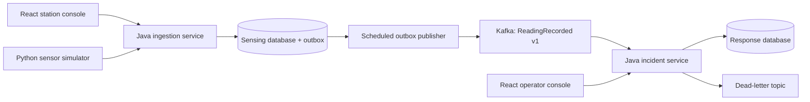
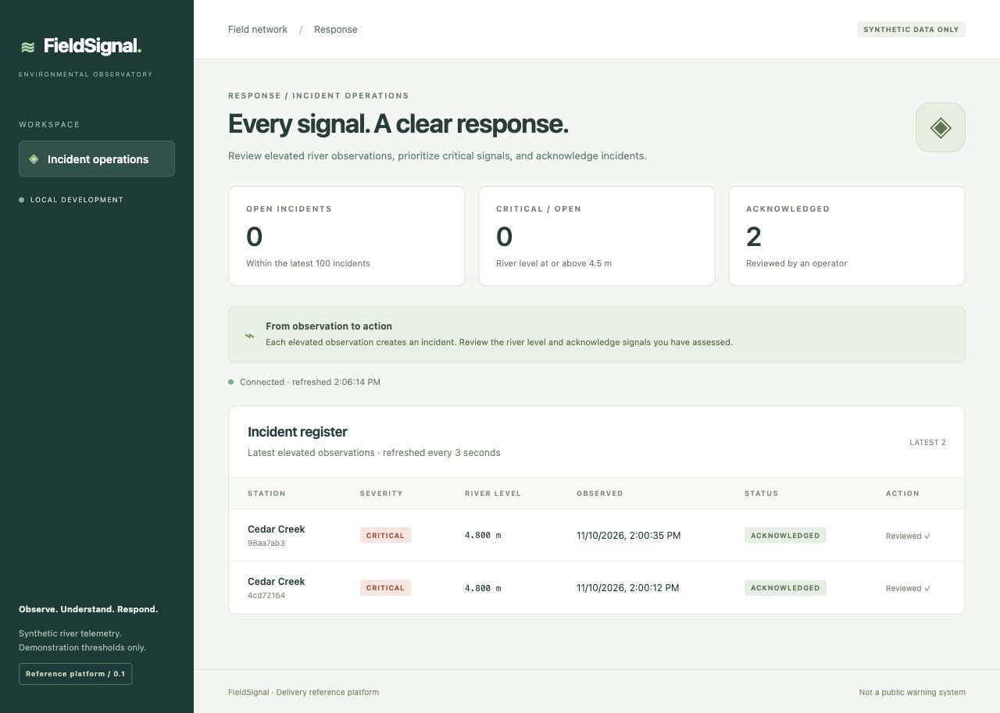

# FieldSignal

**An environmental monitoring application demonstrating multi-team delivery from one monorepo.** Synthetic river sensors feed independently owned sensing and response capabilities through Kafka.

Built as a platform engineering reference in [RPJWeez/delivery-reference-platform](https://github.com/RPJWeez/delivery-reference-platform).

**Status:** the first application slice runs locally: two Java services, two React consoles, shared Java/UI packages, PostgreSQL/outbox, Kafka, and a Python simulator. Signed artifact publication, enforced provenance/SBOM verification, Kubernetes promotion and Apigee deployment remain future milestones. Example release digests are fictional and must never be deployed.



## Run locally



Requires Java 21, Maven 3.9+, Node 22.12+, npm, Docker Compose and Python 3. Helm 3 is needed for chart checks. See [the local runbook](docs/local-development.md).

```sh
make infra                  # PostgreSQL on 55432, Kafka on 9092; initialize topics
npm ci
make build                  # Java packages, shared UI package, both frontends
make dev                    # Both APIs and consoles; Ctrl-C stops them
```

Open [station console](http://127.0.0.1:5173) and [operator console](http://127.0.0.1:5174). Submit **4.8 m**; a critical incident should appear within a few seconds. Acknowledge it in the operator console.

```sh
python3 tools/simulate.py --count 9
make smoke                  # Real HTTP → outbox → Kafka → incident verification
make verify                 # Offline delivery tests + Helm lint/render
make test-java              # Transaction and replay tests using H2
npm run typecheck
make infra-down             # Retains named volumes
```

This uses synthetic data and illustrative thresholds; it is not an operational flood warning system. Local APIs have no authentication and bind to loopback. Gateway authentication is a later milestone.

## Delivery model

**Build by dependency impact; deploy by explicit immutable artifact selection.** Sensing owns ingestion and station console. Response owns incidents and operator console. Platform owns shared packages and the reusable chart. A shared-library change can rebuild several consumers without automatically deploying them.

The outbox makes database writes and publication intent atomic. Event delivery is at least once. Incident replay does not duplicate incidents or reset acknowledgments. Helm rollback covers a bounded Kubernetes release; it is not a distributed transaction.

## Explore

| Location | Purpose |
| --- | --- |
| [Application plan](docs/fieldsignal.md) | Domain, team boundaries and target components |
| [Architecture](docs/architecture.md) | Delivery design and tradeoffs |
| [Release protocol](docs/release-protocol.md) | Build once, verify, select and promote |
| [Roadmap](docs/roadmap.md) | Delivered capabilities and acceptance criteria |
| [Component catalog](catalog/components.json) | Build graph, ownership and release units |
| [Progress](PROGRESS.md) | Verification evidence and next actions |

The repository has not yet been assigned an open-source license.
