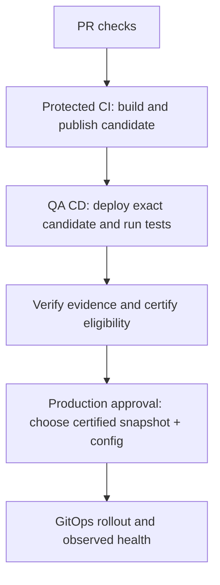

# Application snapshot golden path

Status: proposed architecture and implementation plan. This is a design pressure test, not a claim that the new behavior is implemented or that its acceptance tests have run.

This proposal replaces the earlier independent-library release-guardrails proposal for application-private code. The current architecture and workflows remain in force until the migration gates below pass.

## Decision in plain language

One application lives in one source repository. Its internal libraries are source modules, not separately released products. Every application snapshot represents one source commit and recorded build inputs. CI chooses the complete image set; a separate QA CD workflow tests that immutable snapshot; certification establishes production eligibility; a reviewed production promotion selects a certified snapshot and configuration revision.

A contributor changes code and tests, runs the normal verification command, and opens a PR. They do not assign internal library releases, edit adopter pins, select image digests, assemble candidates, or coordinate registry publications.

Services remain separate processes and images, with separate ownership and appropriate runtime boundaries. The snapshot is the unit of QA testing, certification, promotion, and normal rollback. Kubernetes rollout is gradual, not a transaction; database, API, event, and cached-client compatibility still matters.

## Consolidated review: assumptions corrected

| Assumption challenged                                                   | Reviewed decision                                                                                                                                                                           |
| ----------------------------------------------------------------------- | ------------------------------------------------------------------------------------------------------------------------------------------------------------------------------------------- |
| A new monorepo tool will eliminate release-policy complexity            | Simplify private-library consumption and release boundaries first. Keep Nx where useful; replacing it is not a prerequisite.                                                                |
| Private modules mean there are no versions/history/rollback             | Git preserves source revisions and images preserve built code. Independent old-version selection within a new checkout is the tradeoff; existing images/snapshots remain recoverable.       |
| Every library is private because all visible consumers are in this repo | Audit actual external consumers before retiring any published coordinate. Explicit external SDKs retain a proper release boundary.                                                          |
| A complete snapshot requires unconditional clean builds                 | Completeness is a release property. Selective validation and correctly keyed caches can coexist with it. Benchmark before removing optimizations.                                           |
| Tools supporting caches means CI already has a shared cache             | Current npm download caching is not Nx task/Docker layer/Maven cross-run caching. Configure and validate the selected storage explicitly.                                                   |
| CI publication includes deployed-app testing                            | CI ends at immutable candidate publication. QA CD is a separate environment/harness capability that still needs implementation.                                                             |
| QA passed means production may deploy                                   | Certification evaluates trusted evidence and current policy; production approval and target-config validation remain separate.                                                              |
| Certification must be a new repository/workflow/human gate              | It is a distinct authority/capability; it may be a protected final CD job. Do not multiply approvals unless policy requires it.                                                             |
| Moving bytes to a certified location creates eligibility                | Copying is optional distribution/isolation. Eligibility comes from an authorized decision and enforcement; production read-only credentials are not sufficient by themselves.               |
| A chart copy moves the whole application                                | The chart references external image URLs. Copying/readdressing the closure requires explicit handling; rewriting values changes the candidate digest.                                       |
| Any Git ref named main is inherently unsafe                             | Following protected main is normal for GitOps desired-state reconciliation. Runtime config used by that desired state must be fixed to the reviewed revision when immutability is required. |
| An eligible artifact is safe forever and in every environment           | Evidence has scope, age and policy constraints. Check current eligibility and the target configuration; make revocation and recovery rules explicit.                                        |
| One snapshot means simultaneous runtime cutover                         | Desired state is coherent; pod rollout, cached clients, messages and databases still span old/new behavior.                                                                                 |
| Database rollback risk is caused by this design                         | It is a pre-existing delivery risk. Snapshot rollback must not conceal it or claim to reverse external state.                                                                               |
| A template is low-maintenance because it uses standard file formats     | Compose, build targets, Helm and tests can still drift. Choose clear authorities, validate necessary cross-links, and prove the template on real second-app builds.                         |

The principal default is one releasable business application per source repository. If unrelated products need independent schedules and long-lived library versions, do not force them into a shared snapshot boundary; review the boundary or choose an explicit alternative profile.

## Scope and limits

The default targets an application with containerized web frontends, HTTP APIs, workers, scheduled jobs, application-private libraries, and platform-provided databases, queues, and external services. Multiple teams can contribute, but the application shares a development baseline and release candidate.

“90%” is a product goal to measure against actual adopting applications, not a claim that a sample repository proves universal coverage. SDKs consumed outside the application, independently maintained product versions, mobile/desktop distribution, air-gapped environments, and long-running data migrations require named extensions. We will not make the default configurable enough to impersonate every operating model.

## Findings from the repositories

- The source architecture already describes one business application and whole-application qualification/promotion, but independently publishes its Maven parent/libraries and UI package.
- PR checks build workspace/reactor source, while image publication deliberately installs published dependencies. This creates version/pin work and different internal resolution paths.
- Nx supplies both affected validation and publication selection. Its Maven integration adds an experimental dependency-analysis/execution layer to a native Maven reactor.
- Dockerfiles currently package prebuilt host outputs. Local development also has a Python process launcher. Container build inputs are therefore not yet the complete build contract.
- The deployment repository's candidate workflow accepts a manually authored candidate directory/version and verifies individual images, but does not require the complete image set to belong to one application source revision.
- Environment Argo Applications pin the candidate digest but follow `main` for the configuration source. Configuration can therefore move independently of the reviewed candidate/configuration pairing.
- Deployment workflows pin older copies of source actions. The qualification caller must be migrated deliberately; changing only the action SHA would not supply the newly required hook/checkout inputs.
- CODEOWNERS currently has one catch-all owner and demo approval settings. This demonstrates review routing, not multi-person production governance.

Reviewed sources: source `docs/architecture.md`, `docs/release-protocol.md`, Maven/npm manifests, Dockerfiles, `.github/workflows`, and `.github/actions`; deployment repository [candidate workflow](https://github.com/RPJWeez/fieldsignal-deploy/blob/main/.github/workflows/candidate.yml), [configuration workflow](https://github.com/RPJWeez/fieldsignal-deploy/blob/main/.github/workflows/ci.yml), and [production Application example](https://github.com/RPJWeez/fieldsignal-deploy/blob/main/environments/production/application.yaml.example). Remote findings reflect the review, not a guarantee that future main remains identical.

## Target developer experience

The golden path exposes three documented entry points, with ordinary native commands available for IDE/debug workflows:

```text
make dev       Start the application and local test dependencies
make verify    Run the supported build/test checks
make stop      Stop local processes without destroying persistent data
```

These names describe the proposed interface; the current Makefile implementation must change. Make remains a short command wrapper, not a release engine. Destructive volume reset is a separate, explicitly named command.

The required local tools should be Git and the supported Docker/Compose toolchain. Make is an optional convenience wrapper; document the equivalent native Docker commands so a second command-runner installation is not a prerequisite. Java/Node toolchains can run in pinned containers; developers can install the same versions locally for faster IDE loops. Compose provides local topology, health checks, and optional watch/rebuild behavior. Do not add another custom process supervisor.

| Contribution                            | What the developer does                                                           | What the platform handles                                                        |
| --------------------------------------- | --------------------------------------------------------------------------------- | -------------------------------------------------------------------------------- |
| Change private library code             | Edit library and any broken callers; test; PR                                     | Build consumers from the same checkout; no package bump                          |
| Change one service/frontend             | Edit code/tests; PR                                                               | Build and test the application snapshot                                          |
| Update an external dependency           | Update native manifest/lock; PR                                                   | Resolve/record exact inputs and build a new snapshot                             |
| Add a service, worker, or scheduled job | Use the example/generator; add native build, runtime definition, tests, and owner | Discover build targets; validate completeness; include it automatically          |
| Change runtime templates                | Edit the app-owned Helm chart; PR                                                 | Package the chart with the new snapshot; no manual chart release version         |
| Change environment settings             | Configuration PR through the deployment repository                                | Validate the exact candidate/configuration pairing; run appropriate smoke checks |
| Release or recover                      | Select a certified snapshot, or select a retained rollback pair                   | Propose the GitOps change, verify policy, and observe rollout                    |

A breaking library refactor still needs caller changes, and tests can fail until those are correct. The platform removes version administration, not the engineering consequences of a code change. Prefer small compatible merges and tested feature flags for unfinished features; runtime behavior-flag changes are reviewed configuration changes, not a back door around candidate qualification.

## Tooling and abstraction boundaries

### Native compilation and workspace dependencies

- Maven owns Java modules, dependency ordering, and tests through its reactor. Use one centrally managed internal module version/convention so internal pins cannot drift. That value is build metadata, not an independently published release. Internal modules must resolve from the current reactor; clean verification must not silently fall back to a previously installed application library.
- Existing npm workspaces own JavaScript package relationships. Mark application-only packages private and link them locally. Source-linked UI exports or an explicitly ordered compiled-workspace build are both native options; prove the selected one before migration. `npm ci` must work on an empty checkout without downloading application-private releases.
- External dependencies remain governed and pinned using native manifests/lockfiles, parent/BOM constraints, and immutable base images. Record the actual resolved dependency inventory; Maven does not become reproducible merely because direct versions look fixed.

Maven's reactor and npm workspaces already supply these capabilities: [Maven modules](https://maven.apache.org/guides/mini/guide-multiple-modules.html), [npm workspaces](https://docs.npmjs.com/cli/v11/using-npm/workspaces/).

### Container builds as the portable application build boundary

Use multi-stage Dockerfiles that consume the complete source checkout and invoke Maven/npm natively. They must not depend on a developer's `target`, `dist`, `node_modules`, or Maven cache contents.

Use Docker Compose for local services and Docker Buildx Bake for the application build target group. Bake can consume Compose build definitions and layer standard release settings rather than maintaining a custom component/build catalog. Its native metadata supplies image digests. Tests, fixtures, database images, and development-only containers are explicitly excluded from the publishable application group.

Pick a single authoritative build definition for each deployable. CI derives the expected image set from the resolved native Bake application group. Helm remains the authority for runtime workloads; a small validator verifies that every application workload references a known image and no required build target is silently omitted. Shared images used by multiple roles and pinned third-party images have explicit native runtime declarations.

This is standard tooling, not a promise of zero configuration: [Bake and Compose](https://docs.docker.com/build/bake/compose-file/), [Compose Watch](https://docs.docker.com/compose/how-tos/file-watch/).

### Nx decision — retain it unless a measured proof justifies replacement

Keep Nx initially for useful task orchestration, affected validation, and caching. Private libraries and complete application snapshots do not require its removal. Maven/npm remain the authorities for native compilation and dependency resolution. If the experimental Maven integration proves unreliable, use a coarse native reactor task within Nx before considering replacement; acknowledge that this gives up some module-level precision.

Do not build a replacement dependency graph or a script framework to reproduce Nx. Compose/Bake is a candidate standard container interface, not an unconditional migration prerequisite: keep working build commands unless the cold-build/developer-experience proof demonstrates a benefit. A native full-build reference validates the selective path; it is not a mandate to run clean uncached builds for every change.

Measure affected/full and cold/warm behavior. Preserve selective PR checks where proven sound. For initial snapshot creation, invoking the complete application image build group with a configured native cache is a conservative starting point. Skipping entire image targets or carrying older image selections forward requires complete input tracking and a validated reuse path, not merely a file-path guess or a mutable tag. Snapshot completeness does not imply freshly compiling every member.

Do not adopt Bazel, Pants, a package-manager migration, or a release-versioning framework as part of this change. Replacing Nx is a later decision, made only if native tooling demonstrably lowers complexity without losing required correctness or performance.

### Cache implementation is explicit work

Current `setup-node` caching saves npm dependency downloads. There is no configured persistent shared Nx task cache or Docker build-cache import/export in the reviewed workflow, and no explicit cross-run Maven dependency cache. Do not assume caches exist because tools support them.

If retained, configure Nx cache storage/restoration and complete task inputs/outputs. Configure Docker cache import/export with appropriate target scopes; choose the supported registry or Actions backend after checking runner capabilities, quotas, and trust boundaries. Download caches for npm/Maven are different from reusable compilation/test outputs. Document ownership, cache eviction, invalidation for tools/locks/shared sources, and cold-cache fallback. Untrusted PR writes must not become a trusted main cache authority.

Gate optimizations with tests for changed private libraries, locks, base images, build configuration, generated code, and environment-independent runtime templates. Track runner minutes and PR duration; decide from measurements rather than “build everything is simple” or “caching makes it free.” [Docker cache export/import documentation](https://docs.docker.com/build/cache/backends/gha/).

### Small, bounded platform integration

Custom integration is limited to:

1. Bind the standard build metadata to native Helm image values and reject missing/unexpected images.
2. Verify snapshot completeness, trusted provenance, configuration policy, QA evidence, and certification.
3. Render human-readable reports and proposed promotion diffs.

No custom dependency graph, semantic-version engine, package rewriting, candidate DSL, component inventory format, or general migration orchestrator. Generated reports and attestation payloads are evidence, not another editable source of truth.

App-specific tests, database migrations, fixtures, health checks, and ports remain application-owned. Their presence is necessary application definition, not platform boilerplate to infer automatically.

## Repository responsibilities

| Location                            | Owns                                                                                                                   | Does not own                                                              |
| ----------------------------------- | ---------------------------------------------------------------------------------------------------------------------- | ------------------------------------------------------------------------- |
| Application source                  | Code, private modules, native builds, app Helm templates/defaults, config schema, contracts, tests, QA fixture profile | Production secrets or manually selected image combinations                |
| Reusable platform workflows/actions | Standard build, evidence, snapshot assembly, CD/certification interfaces, reporting and policy checks                  | App business rules, hardcoded service names, custom dependency resolution |
| Deployment repository               | Environment settings, secret references, reviewed certified-snapshot/configuration pins, promotion history             | Component builds or assembling arbitrary image sets                       |
| Platform infrastructure             | Cluster, databases/queues, credentials, environment capabilities and backups                                           | Pretending source rollback reverses external state                        |

Initially keep reusable mechanics versioned with this reference implementation; extract them into a dedicated pinned workflow package only after the second application proves the interface. This avoids publishing an unstable framework and then patching every app.

A minimal supported app supplies identity/registry settings, native application build group, Helm chart/schema, and named verification/qualification targets. Use validated structured inputs and conventional targets; do not require per-service pipeline edits or a long list of arbitrary shell hooks.

## Snapshot identity and lifecycle

A snapshot is a standard packaged Helm application chart with exact image digests and its required vendored chart dependencies. The app-owned chart comes from the application source revision; a genuinely shared platform chart may remain an externally versioned, locked dependency.

CI generates a valid chart package version and records the source SHA as application metadata. No developer manually increments internal library, application, or app-owned chart release numbers. Human release names may label a snapshot; the digest remains its authority.

A source SHA can produce more than one build attempt or builder-policy revision. Snapshot identity is therefore the immutable candidate digest plus provenance recording the application SHA, workflow/builder revision, toolchain and external input identities, run, and attempt. Never assume commit SHA alone uniquely determines all build inputs.



These are logical capabilities and privilege boundaries, not a requirement for four repositories or four independent human approvals. CI and QA CD are separate workflows. Certification can be a separately protected final CD job or its own workflow. Production selection/deployment is a distinct decision. Default certification is automatic when its technical policy passes; any additional compliance approval is explicit. The normal human production decision should not be duplicated under several names.

Terminology:

- **Candidate**: immutable Helm application chart published by CI, containing complete exact image selections. It does not include image layer bytes or database state.
- **QA-tested**: that exact candidate passed a recorded deployment/test run.
- **Certified**: an authorized policy decision accepts sufficient QA/build/security evidence and establishes production eligibility.
- **Promoted to production**: a reviewed production desired-state change selects the certified candidate plus a fixed configuration revision.
- **Deployed healthy**: the runtime reconciled and passed the deployment health checks. A merge or approval alone does not establish this.

A published candidate is not automatically QA-tested, certified, promoted, or healthy. Reports show each state separately. “Snapshot” means the published Helm candidate package identified by OCI digest, not a new custom release format or a Helm-managed installed release. Argo CD uses Helm for rendering in this architecture.

### PR behavior

Run the same native source checks and container build definitions used for main, plus application integration smoke checks with local containers/fixtures. PR images stay local/ephemeral. No permanent package publication, production deployment, or privileged candidate signing occurs.

The PR suite is fast feedback, not proof that a future main digest is qualified. Main revalidates the actual merged revision. Require fresh-base checks or a correctly configured merge queue; enabling a queue includes its workflow trigger and checks.

### Protected CI behavior

1. Check out one exact protected source revision and pinned workflow/tool inputs.
2. Run source verification. Selective validation remains available through Nx where tested; use the native full build as a correctness reference.
3. Build the complete candidate image set through the supported build interface, using deliberately configured caches. No manual component-selection input.
4. Publish resulting images and required SBOM/provenance/signatures. Registry pushes need not be atomic; do not advertise a snapshot as complete until required members/evidence exist.
5. Generate image values, verify inventory completeness and trusted provenance against expected application/build inputs, then publish/sign the Helm candidate. OCI labels alone are insufficient proof.
6. Report **candidate published; QA not yet completed**. Hand the exact candidate digest to QA CD. CI does not deploy the application or certify it for production.

Candidate creation moves out of manual deployment-repository candidate directories into source CI. The deployment system consumes, tests, certifies, and promotes immutable candidates. Runtime qualification is a separate capability, not a hidden extra source-build step.

### QA CD contract — implementation is a separate workstream

QA CD takes an exact candidate digest, verifies its source/build identity and completeness, deploys it without rebuilding or replacing images, waits for readiness, and runs the application functional/integration harness. It owns environment preparation, fixture isolation, diagnostics, result recording, and cleanup where applicable.

This is an actual deployment/test pipeline. The reviewed repositories contain scripts, tests, and workflow scaffolding, not a demonstrated end-to-end running CD capability. This plan defines its input/output contract only; durable QA versus ephemeral namespaces/clusters, infrastructure ownership, test-data management, capacity, and harness operation require a separate CD design and proof. Do not count CI as production assurance until that exists.

A durable QA environment must serialize incompatible deployments or isolate them. Namespace isolation alone does not isolate shared Kafka topics, databases, fixtures, or external sandboxes. Bind test results to the candidate actually observed running, not just the input parameter; verify rollout completion and prevent another run from changing the environment during tests. Temporary environments must have a cleanup path for interrupted runs.

QA evidence records candidate digest, test-suite revision, configuration/profile digest, relevant data fixture/platform identities, architecture/coverage, result, and time/run identity. The default harness comes from the candidate source revision; a reviewed newer test revision may be used for deliberate requalification and must be recorded. QA success is evidence, not an unrestricted authorization to deploy anywhere.

Default to one declared deployment architecture with runtime coverage. Multiple architectures need an explicit coverage policy; cross-building alone is not runtime verification.

### Certification: eligibility without modifying the artifact

An authorized certification job verifies the exact candidate digest, trusted build identity, sufficient signed QA evidence, required security policy/results, and any required approvals. It produces a signed eligibility decision bound to that digest and identified evidence/policy versions. CI publishing authority is not certification authority; the QA test role does not implicitly gain production deployment privileges.

Use one registry plus digest-bound certification as the initial model. No artifact copy or `certified` tag is required. Production automation verifies certification and current policy before applying desired state. Registry read access or a mutable tag alone is not approval. If stronger cluster enforcement is required, choose an off-the-shelf admission/GitOps policy integration and test that alternate deployment routes cannot bypass the rule; a PR check alone does not constrain cluster administrators or direct kubectl access.

Certification is not an eternal guarantee: define how evidence freshness, policy updates, critical vulnerabilities, and revocation affect new deployments and rollback. Re-evaluate current policy when promoting; new scans or rerun tests can certify the same artifact without rebuilding it if its bytes remain suitable. Do not restart running production solely because an eligibility check changes without a separate operational response policy.

Separate candidate/certified repositories are an optional isolation profile, not the default. If enabled, only promotion can write certified storage and production may consume only approved locations. Copy the complete image/chart/evidence closure and verify destination digests/verification behavior. A chart's image URLs are strings, not OCI dependencies followed by `oras cp`; changing those URLs changes chart bytes and invalidates a claim of byte-identical promotion. Design addressing/mirroring before adopting this profile. A changed chart requires a new identity and the required validation. [ORAS copy semantics](https://oras.land/docs/commands/oras_cp/).

### Build reuse and retries

Preserve proven affected validation. For the initial snapshot builder, invoke the complete application image target group with explicitly configured caches, benchmark its overhead, and compare against the full-build reference. This is not a requirement to clean/recompile/retest every component or force new digests when outputs are identical. Native build-cache reuse is allowed; skipping entire image builds or reusing an older-origin image needs evidence of unchanged relevant inputs and compatibility with the declared snapshot source. Do not add bespoke cross-snapshot image carry-forward logic just to save a small amount of runner time.

Retries reconcile digest-addressed publications and missing evidence. Before a snapshot exists, partial image uploads are inert and never promotable. After a snapshot exists, retry QA tests/certification against that digest without rebuilding it. A deliberate rebuild produces a distinct build record and, if contents/metadata differ, a new snapshot requiring qualification. Never replace files under an existing immutable identity.

### Documentation-only changes

Permit a narrow, tested exemption for docs outside build, test, packaging, and runtime inputs. Uncertain changes take the full path. A file rendered into the frontend, a changed Docker build context input, or a changed policy is not automatically “docs-only” because of its extension.

## Promotion and immutable configuration

Production promotion proposes exactly one certified snapshot digest and one configuration revision. Humans do not edit individual images in environment values or candidate files. Reject extra Helm parameters, alternate values files, or other override routes that could change that selection.

Remove the mutable configuration-source `main` reference from active environment Applications. Configuration must be pinned to a known immutable commit/artifact. Avoid a self-referential commit: commit configuration content first, then have the promotion change pin that existing revision. The promotion pointer must not contain its own not-yet-existing commit SHA.

Validate prospective environment values using the selected snapshot's schema and supported capability profile, not only the newest main schema. A prior snapshot's valid config pair must remain assessable for rollback, subject to current revocation and data-compatibility policy. Define a bounded, auditable emergency approval path for a needed rollback whose old certification expired; do not create a permanent bypass or assume revoked vulnerable artifacts are always acceptable. QA evidence binds snapshot digest, test revision, QA fixture/config digest, architecture, and relevant infrastructure/tool inputs; certification references the accepted evidence and policy. Promotion validates permitted target-environment differences; qualification does not claim all environments or secret values are identical.

Following main for the outer GitOps desired-state pointer is allowed: a reviewed merge is how the selected snapshot/configuration changes. The problem is an independently moving runtime configuration source, not the existence of a main branch. Resources, endpoints, replica counts, and secret references follow typed policy. Changes affecting business behavior, migrations, or compatibility require the appropriate candidate/configuration validation. Config-only changes do not rebuild images, but must validate the new deployment pairing and have health checks. Secret payloads remain outside artifacts; record nonsecret identity/version references where available.

A narrowly authorized integration may propose a nonproduction change after that stage’s declared eligibility policy succeeds. Production proposals require certification. Cross-repository PR creation is enabled explicitly and receives only the permissions it needs. Auto-deploying a nonproduction environment is an explicit policy choice. Production requires a reviewed promotion. Serialize promotions per environment through sync/health observation; an older, slower build must not silently replace a newer desired state. Deliberate rollback is explicit, not rejected merely for being older.

## Governance defaults

- Protected source and deployment branches, required checks, no force pushes/deletion, and CODEOWNERS for application areas, contracts/migrations, deployment settings, and platform workflow/policy changes.
- Owner review for sensitive boundary changes. Separate production approval where there is a separate reviewer; a solo-maintainer demo is explicitly a weaker profile, not simulated separation of duties.
- Build/publish only from approved protected refs and pinned workflow identities. Protect QA attestation, certification, and production deployment roles separately. PR jobs remain unprivileged. Workflow changes receive platform-owner review.
- Verify snapshot/image provenance against allowed repository, workflow, source revision, and policy. Verify SBOM/evidence completeness, QA test subject, certification issuer/subject, and current eligibility policy. Treat registry/authentication outages as failed checks, never “artifact absent.”
- Validate least-privilege, namespace-scoped Argo resource policies for supported Deployment, Service, worker/job, config, and ingress patterns. Infrastructure ownership is separate. Do not claim Job/CronJob support while the chart/AppProject only allows Deployment/Service.
- Keep complete retained closures for deployed snapshots, supported rollback pairs, migrations, tests/evidence, and required external artifacts. Cleanup is report-only until reachability tests pass; no blind untagged-manifest deletion.
- Summaries use plain status and exact next actions, link failed checks, separate planned/actual work, and never infer publication from selection. Test fixtures cannot write runner summaries; result records remain bound to a run/attempt.

## Common failures and recovery

Default policy should permit only a documented, versioned compatibility window; tests cannot establish compatibility with every historical client or event. Runtime boundaries remain versioned through APIs/events/data contracts, even though application-private source libraries are not released. Use compatible expand/migrate/contract changes, staged removals, and consumer/provider tests. A migration must be idempotent under its native migration tool and must not rely on simultaneous pod replacement. Long backfills are application operations with explicit readiness gates, not an unbounded job hidden inside deployment.

Normal rollback selects a retained previous snapshot/configuration pair and observes rollout. It is blocked if known data/contract changes make it unsafe. Source revert is a new verified build, not a rewrite of an old snapshot. Credentials, external endpoints, data, Kafka history, and infrastructure availability still constrain recovery.

Incomplete features land behind reviewed, tested disabled behavior or as compatible increments. Teams cannot keep arbitrary older internal-library versions inside new builds; if that autonomy is essential, this application boundary is wrong or an explicit published-package boundary is needed.

Default hotfix path: fix main and promote its next certified snapshot. If unrelated main work cannot ship, create a protected maintenance branch from the deployed source revision, apply the fix, run the same workflow, and qualify a complete snapshot. Trust policy must explicitly allow that protected branch; do not bypass checks or mix one image into an old candidate. Forward-port the fix to main and track completion.

## Pressure-test matrix

These are design expectations and executable acceptance cases to implement. They are not reported as already-passing runtime tests.

| Scenario                                                            | Golden-path response                                                           | Required proof / prevented bad path                                                                       |
| ------------------------------------------------------------------- | ------------------------------------------------------------------------------ | --------------------------------------------------------------------------------------------------------- |
| Private Java library changes                                        | Build reactor and all application images from the checkout                     | Both consumers contain intended source; empty-cache build cannot fetch an older private library           |
| UI library changes                                                  | Workspace consumers build together                                             | No npm version bump/publish; root frozen install works with no private package access                     |
| Developer forgets internal version bumps                            | No contributor-managed release version exists                                  | Central Java convention and private workspace policy reject drift                                         |
| One caller breaks after a refactor                                  | PR fails before merge                                                          | Error names caller/test; no publish/promotion                                                             |
| Breaking change in a service API/event                              | Contract and integration checks fail until migration is compatible             | Old/new runtime overlap and persisted/replayed events tested                                              |
| One service implementation changes                                  | Whole snapshot build runs                                                      | No manual digest choice; optimization cannot omit a required member                                       |
| Docs outside production inputs change                               | Docs checks only                                                               | Adversarial fixtures prove referenced/build-input docs do not take this exemption                         |
| External dependency or base image update                            | Native locked-input PR and new snapshot                                        | Inventory changes visible; third-party ranges/mutable release inputs rejected by policy                   |
| New worker or scheduled job                                         | Native target/runtime/tests/owner added                                        | Real Job/CronJob chart rendering, AppProject allowance, fixture execution and failure handling            |
| Service removed                                                     | New complete inventory omits it deliberately                                   | No dangling Helm/env references; migration and prune consequences reviewed                                |
| A new image is omitted from assembly                                | Snapshot completeness check fails                                              | Expected native build group matches deployed application image references                                 |
| Someone pastes an unproven image from another commit                | Provenance/assembly check rejects it                                           | Signature alone does not authorize mixing application revisions                                           |
| User overrides image via Helm parameter/extra values                | Deployment policy rejects all override routes                                  | Rendered workloads still match the snapshot's exact image set                                             |
| One image push or attestation fails                                 | No eligible snapshot                                                           | Published fragments cannot be promoted; retry resumes/reconciles safely                                   |
| Snapshot uploaded, qualification fails                              | Status remains unqualified                                                     | Neither automatic promotion nor manually edited digest bypasses qualification                             |
| Qualification rerun                                                 | Same immutable snapshot, new evidence attempt                                  | No rebuild occurs; changed test/config inputs are recorded and policy-checked                             |
| Main advances during a long run                                     | Each run retains its exact source/input identity                               | No checkout of moving main midway; no stale run overwrites a newer environment                            |
| Two promotions race                                                 | Environment lock and refreshed desired-state checks                            | Serialize through health observation, not just workflow creation                                          |
| Deployment stalls halfway                                           | Mark recovery required; stop automatic advancement                             | Readiness diagnostics and compatible rollback/roll-forward; no atomic-runtime claim                       |
| Candidate unchanged, config changes                                 | Validate the exact new pairing without image build                             | Pinned config cannot drift after review; behavior-changing config gets appropriate testing                |
| Old snapshot rolled back after schema changes                       | Validate retained pair with its schema and data compatibility                  | Unsafe rollback blocked; previous images alone are not assumed sufficient                                 |
| Secret rotates                                                      | Validate availability/smoke as appropriate, no image rebuild                   | No secret material in candidate/evidence; old references do not silently masquerade as reproducible state |
| Database adds a nullable field                                      | Compatible migration and old/new component tests                               | Idempotent schema change, controlled execution and rollout                                                |
| Database drops a field or starts a long backfill                    | Staged migration path or explicit specialist review                            | No irreversible change hidden behind “rollback”                                                           |
| Production hotfix while main has unfinished features                | Protected maintenance snapshot path                                            | Full candidate from a permitted source ref, qualification, and forward-port                               |
| Retry or rebuild of the same source SHA                             | Separate build-attempt identity; immutable artifacts                           | No assumption that SHA uniquely determines builder/tool inputs                                            |
| Cache is empty/stale/untrusted                                      | Clean native build or verified cache use                                       | Same tests with/without cache; no cache-only module resolution                                            |
| Fork PR needs private external dependencies                         | Documented read-access policy and clear validation status                      | No privileged execution of untrusted PR code to work around package reads                                 |
| Multi-architecture release                                          | Require declared runtime coverage, or restrict the supported platform          | Building an arm64 image alone is not proof it ran correctly                                               |
| Another application adopts template                                 | Configuration, native targets/chart and business tests supplied                | No FieldSignal names/ports/topics in reusable workflow code                                               |
| External SDK needs independent releases                             | Explicit package-product extension                                             | Do not reintroduce release machinery for all private modules                                              |
| Registry or environment is unavailable                              | Clear failed/incomplete state; no promotion                                    | Authentication errors are not missing-artifact signals; retries do not change intent                      |
| QA says success but shared test infrastructure changed during tests | Isolate or serialize deployments and state, record observed candidate identity | A test run cannot certify a different or mixed running application                                        |
| CI principal attempts to mark a candidate certified                 | Reject the unauthorized issuer                                                 | Workflow identity/role tests enforce separation; location or tag names are not authority                  |
| Certification is expired, revoked, or predates a required policy    | Block normal promotion or require approved re-evaluation                       | Current eligibility is checked at deployment, with a separately governed recovery path                    |
| CD completion event refers to the wrong repository/ref/run/artifact | Reject candidate handoff                                                       | Verify exact immutable subjects and trusted evidence; no latest-run name matching                         |
| Source is unchanged but base/tool inputs change on rebuild          | New recorded build identity and required QA/certification                      | Source SHA alone is not used as a unique release identity                                                 |
| A new snapshot retains identical workload image/config              | No restart solely to change an application-wide build label                    | Runtime changes drive rollout; avoid global version metadata in every Pod template unless intentional     |
| Outer GitOps pointer follows protected main                         | Permit reviewed desired-state changes                                          | Runtime candidate/config references remain fixed; do not confuse reconciliation with config drift         |

The pressure test establishes six mandatory boundaries: complete source/input-bound inventory; separate published/tested/certified/deployed states; enforced certification and current policy; fixed runtime configuration; isolated/serialized environments; and data-aware recovery. Tool replacement and artifact copying are not mandatory boundaries.

## Migration plan and stop/go gates

### Phase 1 — Adopt the contract and prove the build path

Deliver a proposed ADR, agreed scope, contributor commands, and a small proof using this application's Java/UI dependency chains. Retain Nx and benchmark selective/full and cold/warm paths before changing orchestration. Add cold-cache builds, container test stages, application Compose topology, native Bake application group, and the full snapshot completeness tests. Keep the existing release path active while proving replacements; the proof cannot promote.

Gate: a fresh clone builds/tests both ecosystems without application-private registry reads or prebuilt host outputs. A second app fixture has different identities, paths, runtime component count, and optional language presence. Record cold/warm build times and local resource use. Do not claim success from a graph-only fixture.

### Phase 2 — Private modules and removal of independent releases

Switch Java to the central internal-module convention and npm libraries to private workspace resolution. Remove private-library publication targets, registry-consumer image build mode, Maven/npm evidence releases, obsolete registry authentication, and last-successful-publication selection for private modules. Preserve all previously published artifacts/evidence for existing deployments and external consumers until reviewed.

Retain useful Nx orchestration/caching over the proven native builds; replace only demonstrated weak integrations. Remove Nx only after a separate benchmarked simplicity/correctness decision, not as a condition of private-library adoption. Replace the Python process launcher with Compose; keep domain-specific smoke/functional assertions as app code.

Gate: intentional private-pin drift or registry fallback fails on PR; code-only library changes succeed with no version edits; all current business tests pass; public/external package consumers have been audited before disabling publication.

### Phase 3 — Automated complete snapshot creation in CI

Move candidate assembly into source CI. Generate image values from build metadata; automatically version/package the app-owned chart; verify source/builder provenance, expected inventory, and evidence. Remove manual candidate component selection. Establish the immutable candidate handoff and report “published, not yet QA-tested.”

Gate: a real complete candidate is published without any app deployment. Wrong-source, missing/extra image, malformed inventory, failed push/evidence, and retry tests behave as specified. Cache configuration has measured cold/warm results. No environment desired state changes during the proof.

### Phase 4 — Separate CD, certification, and production contracts

Commission and implement the separate QA CD workstream against the candidate handoff; do not hide cluster/harness provisioning inside CI scope. Its actual environment/harness design is a prerequisite to claiming production eligibility. Add protected certification with signed digest-bound decisions, and keep production approval/deployment distinct.

Migrate deployment verification from the old manual candidate signer to the approved source-CI build signer, QA evidence issuer, and certification issuer. Reference exact workflow identities and permitted refs, not just repository names. Preserve narrowly scoped verification for retained legacy rollback candidates; do not leave old manual assembly open for new mixed releases.

Pin configuration revisions, enforce Helm override policy, use candidate-specific schemas, and serialize/observe deployments. Migrate action callers and required hook inputs together. Define how separate workflows authenticate candidate identity and avoid picking a mutable “latest successful run.” Workflow completion alone is not enough: verify event/repository/ref, exact artifact subject, run/attempt and trusted evidence. Keep bootstrap examples inactive until actual qualification/certification succeeds.

Gate: demonstrate a QA deployment/test run, certified eligibility, reviewed production pairing, rejected untested/uncertified/mixed candidate, configuration drift rejection, overlapping promotions, failed rollout, and compatible rollback. Verify that CI cannot mint accepted certification and a failed QA run cannot become eligible. No “merged therefore deployed” success reporting.

### Phase 5 — Portability and operational acceptance

Run the same workflow and governance path on a second application, including an API/worker-only app and a frontend-only app. Exercise web/API/worker/CronJob archetypes and dependency fixture replacement. Provide a one-page contributor guide and a separate operator runbook for recovery/extensions.

Gate: adding a deployable needs only native build/runtime declarations, ownership, and application tests—not workflow service lists or platform code edits. Reusable code contains no FieldSignal assumptions. Execute the pressure matrix's failure injections; publish the results and measured costs/timings. Establish retention/cleanup reporting and the maintenance-branch hotfix drill.

Only after these gates pass should accepted architecture documents and repository protections switch to the new contract. Retire incompatible old workflows and manual assembly entry points so two supported operating models do not coexist indefinitely.

## Definition of done

- A normal library/service/frontend PR does not contain internal release-version or consumer-adoption bookkeeping.
- One documented development/verification path works from a cold clone; native IDE commands remain available. Nx retention/removal and cache performance are measured decisions, not assumptions.
- CI creates complete snapshots automatically, with no hand-authored image matrix or candidate directory.
- Every production-eligible snapshot has complete verified images/build evidence, recorded QA results, and authorized certification for its exact digest. Production promotion also checks current policy and the fixed configuration pairing.
- Promotion/rollback identify exact snapshot/configuration pairs and finish with observed health, not just Git changes.
- Both normal and failure cases are proven on a second application; test results distinguish execution from design expectations.
- The project owns small inventory/policy/report adapters, not a package release framework or dependency engine.
- The default guide fits on one page. Advanced exceptions do not add daily decisions for normal contributors.
- Coverage is measured by adoption and exceptions: number of special procedures, platform edits needed per new app, PR failure categories, time-to-first-verified-change, CI duration/cost, and recovery drill outcomes. If a frequent use case needs a workaround, revise the default rather than accumulate bypass flags.
