# Reference architecture

## Intent and boundaries

One repository represents one business application, contributed to by several teams. Source co-location provides visibility and consistent tooling; it does not imply synchronized versions or application-wide deployments. FieldSignal monitors synthetic river-level stations and coordinates incident review. Sensing owns ingestion and station console; Response owns incident processing and operator console. See [the application plan](fieldsignal.md).

```mermaid
flowchart LR
  PR[Team pull request] --> CI[Impact graph + tests + contracts]
  CI --> Build[Trusted build on main]
  Build --> Registry[GHCR / Maven / npm / OCI charts]
  Registry --> Evidence[Digest + signed provenance + SBOM]
  Evidence --> Proposal[Team release manifest PR]
  Proposal --> Gate[Verify identity + policy + approvals]
  Gate --> Dev[Team namespace in dev]
  Dev --> Stage[Promote same digests to staging]
  Stage --> Prod[Promote same digests to production]
```

## Proposed technology choices

| Concern | Choice | Reason |
| --- | --- | --- |
| Java | Java 21, Spring Boot, Maven reactor | Familiar ecosystem, selective reactor builds, explicit dependencies |
| Web | React, TypeScript, Vite, npm workspaces | Multiple independently built frontends and reusable UI package |
| Events | Kafka, versioned JSON Schema initially | Explicit evolution rules, consumer isolation and replay demonstrations |
| Edge | Apigee proxy bundles | Version gateway configuration separately from workloads |
| Runtime | Kubernetes, Helm 3 | Common chart, explicit per-team release boundary |
| CI | GitHub Actions | Reviewable public evidence and OIDC-based identity |
| Registry | GHCR plus Maven/npm registries | OCI for images, charts, configuration and release bundles |
| Evidence | Sigstore signatures, SLSA-format provenance, SPDX/CycloneDX SBOM | Bind claims to content digests and trusted builders |
| Deployment | Explicit promotion workflow initially | Straightforward digest selection; GitOps is a later documented alternative |

Implemented dependencies are pinned in the Maven parent and npm lockfile; local infrastructure images are pinned by OCI digest. This document does not claim these controls are already enforced.

## Three different graphs

1. **Build graph:** a shared library change selects its transitive consumers for build/test. A catalog describes dependencies; missing paths conservatively select all builds.
2. **Contract graph:** API and event consumers are verified against compatible interface versions. Runtime coupling does not require simultaneous deployment.
3. **Release graph:** immutable artifacts selected for a single release unit. Build impact does not automatically enroll artifacts in a deployment.

Shared libraries initially compile from the same reactor for development. Before promotion, release builds must consume explicit published, immutable Maven/npm versions, with lockfiles where supported. A consumer built against a new shared library must be a new consumer artifact. Publishing a library never mutates a running service.

## Ownership and isolation

Each workload belongs to exactly one release unit and one team. Each unit has a namespace, service account, namespace-scoped deployment role, and concurrency key `(environment, release-unit)`. Namespaces are provisioned by Platform, outside application releases. Teams cannot apply cluster-scoped resources. NetworkPolicy, ResourceQuota, LimitRange, Kafka ACLs, and per-service database credentials provide additional isolation.

CODEOWNERS is a review routing mechanism, not runtime authorization. Branch rules must require the relevant owner approval; deployment authorization must independently bind the caller to the release unit. The manifest validator's `owner` field alone is not authentication.

## Atomicity means a bounded recovery unit

One chart can render several workloads belonging to the same release unit. Install or upgrade that chart as one Helm release with Helm 3 `--atomic --wait --timeout 5m`. This provides readiness-based rollback, not a distributed transaction or a guarantee that users see all services switch simultaneously. Rolling updates may serve mixed versions. Strict traffic-level cutover requires a separate blue/green routing mechanism.

Database changes follow expand/migrate/contract. Kafka consumers tolerate at-least-once delivery with persisted idempotency keys, retry budgets and dead-letter handling. A transactional outbox bridges database state and event publication. Apigee proxy deployment is a separately versioned change coordinated by backward-compatible contracts. Rollback cannot retract already published events or destructive schema changes.

## Artifact inventory

Every promoted object has a human version and content digest: container image, Maven library, npm package, chart package, API proxy ZIP, schema bundle, environment configuration bundle, and release bundle. Each requires an SBOM or accurately scoped inventory and signed provenance. Artifact metadata records source commit, builder workflow identity, build inputs and dependencies. Promotion carries original digests rather than rebuilding per environment.

Registry tags and version strings are lookup conveniences; deployment resolves by digest. Retention protects all referenced blobs and evidence. Registry authorization prevents ordinary users overwriting release coordinates. Signature verification enforces issuer, repository, workflow identity and approved source ref; accepting any valid signature is insufficient.

## Cost-conscious local demonstration

Start with kind, a single Kafka broker, and one Postgres instance with separate databases/users per service. Use synthetic fixtures. Keep Apigee integration opt-in because a real deployment needs an organization/environment and credentials. A local gateway adapter can exercise HTTP routing, but must never be presented as a real Apigee deployment. Cloud infrastructure and paid services require a separate target decision.
